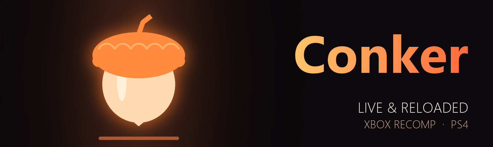

<p align="center">
  
</p>

<p align="center">
  <a href="https://github.com/iHaiDeeZ/ConkerLR-PS4/releases/latest"></a>
  
  
  
  <a href="LICENSE"></a>
</p>

<h3 align="center">Conker: Live & Reloaded, running natively on the PS4.</h3>

<p align="center">
  <a href="https://github.com/iHaiDeeZ/ConkerLR-PS4/releases/latest"><b>⬇ Get the latest release</b></a> ·
  <a href="#getting-started">Getting started</a> ·
  <a href="#controls">Controls</a> ·
  <a href="#the-quick-menu">Quick menu</a> ·
  <a href="#faq">FAQ</a> ·
  <a href="CREDITS.md">Credits</a>
</p>

---

## Overview

ConkerLR brings [conker-lr-recomp](https://github.com/rashevskyv/conker-lr-recomp), rashevskyv's static
recompilation of the original Xbox game (Rare, 2005), to jailbroken PS4 consoles. There's no emulator: the
game's x86 code is lifted to C on your PC and compiled for the PS4's CPU, and the Xbox GPU's commands are drawn
by the recomp's Vulkan renderer on Mesa's RADV driver, adapted to submit work straight to the PS4's AMD GPU.

It installs as an app on the home screen and plays the single player game with a DualShock 4, at a real 60 fps
and 1080p. **L3 + R3** opens a quick menu for the display mode, upscaling, frame rate and render scale.

You bring your own game: nothing copyrighted is in this repository or its releases. No game code, art or
sound. The package you build contains your disc, so never share it.

## Highlights

**The whole game, natively**
- Upstream's recompiled code, with no interpreter or JIT in between, built at -O2 for the PS4.
- The Xbox's audio chip, as the recomp emulates it, out through the PS4 at 48 kHz.
- Saves on the Xbox hard disk in `/data/ConkerLR/save`, kept across updates.

**Sharper and smoother than the Xbox**
- The game's own **60 fps**: its step is time-based, so it's a real 60, not interpolated. 30 is one menu row away.
- Rendered at up to 4x the Xbox's 640x480; **1080p** (225%) by default.
- **FSR 1** (AMD's EASU + RCAS) or bilinear upscaling, FXAA and anisotropic filtering.
- **Fit 4:3**, **Stretch 16:9** or **Wide 16:9** (the game's view widened, Hor+).

**Couch-friendly**
- Settings change from the quick menu while you play, and are remembered.
- PlayStation, Xbox or Switch button icons in the game's prompts.
- A frame counter when you want one.

**When something goes wrong**
- The release build is quiet: one line in `clx_env.txt` turns on logs, the audio report, crash logs, boot
  traces and thread dumps.

## Getting started

**You need:** a jailbroken PS4 with **GoldHEN** (developed on a launch-model PS4) and an FTP connection to it, a
PC with **WSL 2** (Ubuntu, 16 GB of RAM, about 20 GB free), the **OpenOrbis** toolchain (PacBrew), and your
**own** disc of **Conker: Live & Reloaded**, retail **NTSC (North America)**, as an ISO or unpacked.

Its `default.xbe` must have SHA-1 `2232a1b3874d67b4bb4cf53a940420d2dab59535`; the same code with a region-free
certificate (SHA-1 `bef166b2d2f72fef6bc051fd7bc36caadada0b54`) is accepted too.

> **Note:** the build also needs **ps4-kit**, the shared PS4 base of these ports (runtime, Mesa RADV for the PS4,
> VideoOut swapchain, packaging). This release was built with ps4-kit `87a517c`; ps4-kit isn't published yet.

### Building the package

1. Unpack your disc into `~/clx-build/disc` in WSL, for example with
   [extract-xiso](https://github.com/XboxDev/extract-xiso):

   ```bash
   extract-xiso -x Conker.iso -d ~/clx-build/disc
   ```

2. Get the upstream recomp at the commit in [`patches/BASE.txt`](patches/BASE.txt) and apply this port:

   ```bash
   mkdir -p ~/clx-build/src && cd ~/clx-build/src
   git clone https://github.com/rashevskyv/conker-lr-recomp && cd conker-lr-recomp
   git checkout 40a54ee && git switch -c ps4
   git apply /path/to/this/repo/patches/clx-ps4.patch
   ```

3. Link this repository as `~/clx` and ps4-kit as `~/ps4-kit`, then build:

   ```bash
   CLX_RELEASE=1 CLX_VERSION=01.00 ~/clx/scripts/build-clx.sh
   ```

   The first build lifts the XBE to C (about 15 minutes, about 15 GB of RAM) and compiles it. The result is
   **`out/ConkerLR-v01.00.pkg`** (title ID `CLXR00001`, about 4.8 GB with your disc inside). Without
   `CLX_RELEASE=1` you get a development build with every diagnostic on.

4. Copy the package to the console (FTP to `/data/pkg`) and install it with GoldHEN's **Package Installer**.

**Updating:** build the newer version and install it on top of the old one. Your saves and settings live in
`/data/ConkerLR/` and survive updates.

## Controls

| DualShock 4 | Xbox controller |
|---|---|
| Cross / Circle / Square / Triangle | A / B / X / Y |
| L1 / R1 | White / Black |
| L2 / R2 | Left / right trigger |
| OPTIONS | Start |
| Touchpad click | Back (the game's own settings) |
| Left / right stick | Left / right stick |
| L3 / R3 | Stick buttons |
| D-pad | D-pad |
| **L3 + R3** | Open the quick menu |

## The quick menu

**L3 + R3** while playing (again, or Circle, to go back). Up / Down picks a row, Left / Right or Cross changes
it. Changes apply at once, except *Frame rate* and *Button icons*, which apply the next time you start the game.
Everything is saved in `/data/ConkerLR/clx_options.txt`.

| Row | Choices |
|---|---|
| Display | Fit 4:3, Stretch 16:9, Wide 16:9 |
| Upscaling filter | Bilinear, FSR 1 |
| Frame rate | 60, 30 (next start) |
| Render scale | 100% (480p), 150% (720p), 200% (960p), 225% (1080p), 300%, 400% |
| Anti-aliasing (FXAA) | On, Off |
| Anisotropic filter | 1x, 2x, 4x, 8x, 16x |
| FPS counter | On, Off |
| Camera | Classic, Free |
| Invert camera up/down | On, Off |
| Subtitle box | Wide, Classic |
| Button icons | PlayStation, Xbox, Switch (next start) |
| Volume | 0 to 100%, in steps of 20 |
| Exit game | Back to the PS4's home screen |

## Your files

Everything the game writes sits in **`/data/ConkerLR/`**:

- `save/`: the Xbox hard disk's partitions and your save games
- `clx_options.txt`: the quick menu's settings
- `clx_env.txt`: advanced switches, one `NAME=value` per line (see below)
- the shader and pipeline caches
- `clx_log.txt` and crash logs, only with `CLX_DIAG=1`

| `clx_env.txt` line | Effect |
|---|---|
| `CLX_DIAG=1` | Diagnostics on: `clx_log.txt`, the `[audio]` report, ps4-kit's crash log, boot trace and thread dumps |
| `RECOMP_GIL_EAGER=0` | Guest threads take turns in arrival order (the default hands the game's sound mixer the lock first) |
| `RECOMP_MIRRORS=28` | Map all 28 Xbox RAM mirrors (default 1: each view costs the app's flexible memory) |
| `RECOMP_APU_FE_LOCK=0` | The audio chip's commands without its lock (as upstream) |
| `CLX_SKIP_INTRO=0` | Play the boot movie |

## FAQ

**Why isn't there a package to download?**
The package holds the game's recompiled code and your disc. You build it from your own copy; the releases are
source only.

**Does multiplayer or Xbox Live work?**
No. The single player game plays from start to finish; multiplayer and Xbox Live don't.

**It dips below 60 in some places.**
The PS4's CPU is the limit there. Set *Frame rate* to 30 in the quick menu for a locked 30, or lower the render
scale.

**The sound crackles.**
Make sure `clx_env.txt` doesn't set `RECOMP_GIL_EAGER=0`. The default hands the game's sound mixer the lock
first, which fixed the crackles at 60 fps.

**How do I report a bug?**
[Open an issue](https://github.com/iHaiDeeZ/ConkerLR-PS4/issues). Put `CLX_DIAG=1` in
`/data/ConkerLR/clx_env.txt`, play to the problem, and attach `clx_log.txt` and any crash log from
`/data/ConkerLR/`, with the version, your PS4 model and firmware.

## How it works on the PS4

| Part | PS4 |
|---|---|
| Build | ps4-kit's toolchain (clang 21, libc++), runtime and packaging; the lifted code at -O2 |
| Renderer | the recomp's `nv2a_vk` on RADV through volk and ps4-kit's VideoOut swapchain (1920x1080, vsync flips); recording and present on threads of their own |
| Picture passes | `nv2a_vk/ps4_post.h`: display modes, FSR 1 (shaders built to SPIR-V at build time) |
| Guest memory | one 4 GB reservation; RAM, a mirror and the GPU's tiled view are aliasing shared-memory views, other memory comes from direct memory in 16 KB pages |
| Files | the disc is read from the package (`/app0/game`, read-only); the Xbox hard disk (E:, T:, U:, Z:) lives in `/data/ConkerLR/save` |
| Sound | SDL2's PS4 audio driver at 48 kHz; the APU and SDL threads above the game's (priority 400) |
| Pad | scePad behind the recomp's console pad interface (`input/xinput_ps4.c`) |

Bugs found on the way that matter for other ports of this recomp:

- **The Xbox hard disk.** Upstream keeps partition 1 (TDATA, UDATA) in the disc folder. A read-only disc folder
  made the game return to the "dashboard" (invalid hard disk) at boot.
- **Extended VMA.** Where a host lets the layout reserve guest memory above the RAM mirrors, Conker puts its
  sound stream buffers at `0x74000000`+. The APU can't reach them (bit 26 there reads as the low-RAM tag), so it
  played unchanging memory: a hiss over the whole game that sounded like the title screen's rain. Linux and the
  Switch never reserve that range; neither does this port.
- **Sound priority.** Without `RECOMP_GIL_EAGER=1` (the Switch's setting) the game's sound mixer waited behind
  the main thread: crackles at 60 fps.

## Good to know

- Only the retail NTSC disc is supported: the recomp is made for its exact `default.xbe`.
- Save in the game; there are no save states. Your saves carry over to new versions.
- Only the original PS4 has been tested so far. PS4 Pro reports are welcome.

## Thanks

- **[rashevskyv](https://github.com/rashevskyv/conker-lr-recomp)**: the Conker: Live & Reloaded recomp
- **sp00nz**: xboxrecomp, the lifter and runtime under it, and **antoxa2584x**: the flatout2-sw game layer
- **[xemu](https://xemu.app)**: the MCPX APU code that plays the game's sound
- **[Mesa](https://mesa3d.org)**: the RADV Vulkan driver that draws every frame
- **[AMD FidelityFX](https://gpuopen.com/fidelityfx-superresolution/)**: FSR 1
- **[OpenOrbis](https://github.com/OpenOrbis)** and **[PacBrew](https://github.com/PacBrew)**: the PS4 toolchains

Everyone involved, with licences, is listed in **[CREDITS.md](CREDITS.md)**.

## License and disclaimer

This port's own code and scripts are released under the **MIT License**. See [LICENSE](LICENSE). The upstream
files the patch changes keep their own licences (MIT; LGPL-2.1-or-later for the xemu APU code).

This is a fan-made project with no ties to Rare, Microsoft, Sony Interactive Entertainment or the recomp's
authors. Conker and Xbox are trademarks of Microsoft; PlayStation and PS4 are trademarks of Sony Interactive
Entertainment. Please only play games you own. This project won't help you find or share game files.
